<picture>
  <source media="(prefers-color-scheme: dark)" srcset="./assets/header-dark.svg">
  
</picture>

 

我是 Jenks，2016 年开始用 GitHub。前几年写 Android，开源过几个小控件；现在主要用 Godot 4 + C# 做一款多人在线的 2D 游戏。

### 现在在做

- **一款多人在线 2D 游戏** — 客户端 Godot 4.4（自己改过的 Mono 构建）+ C#，服务端 .NET，KCP 联机，MySQL / Redis
- **配套工具** — 地图编辑器（Avalonia）、专用关卡编辑器（TypeScript）、运营后台网页
- **自己用的桌面小工具** — Tauri + React 的本地笔记、桌面悬浮便签、Rust 写的本地智能代理

### 开源

| 项目 | 说明 | 语言 |
| :-- | :-- | :-- |
| [LayoutScroll](https://github.com/Magic-KK/LayoutScroll) | 仿淘宝的上下跑马灯，自动垂直滚动 | Java · ★ 18 |
| [countdownview](https://github.com/Magic-KK/countdownview) | Android 验证码倒计时按钮 | Java · ★ 6 |
| [godot4-csharp-learning](https://github.com/Magic-KK/godot4-csharp-learning) | Godot 4 C# 学习网站，从入门到实战 | HTML |
| [easyarm](https://github.com/Magic-KK/easyarm) | Android 快速开发框架：MVP、AndroidX、常用封装 | Java |
| [node-monitor](https://github.com/Magic-KK/node-monitor) | 团队节点在线状态监控面板 | Node.js |

### 常用

<picture>
  <source media="(prefers-color-scheme: dark)" srcset="https://skillicons.dev/icons?i=cs%2Cdotnet%2Cgodot%2Cjava%2Ckotlin%2Candroidstudio%2Cts%2Creact%2Ctauri%2Crust%2Cpython%2Cmysql%2Credis%2Cdocker&theme=dark&perline=14">
  
</picture>

  

联系我：[jenkskk@gmail.com](mailto:jenkskk@gmail.com)
